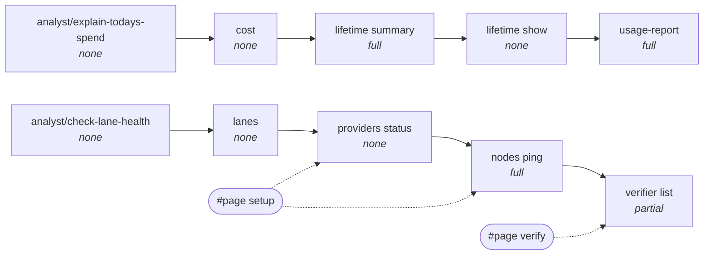
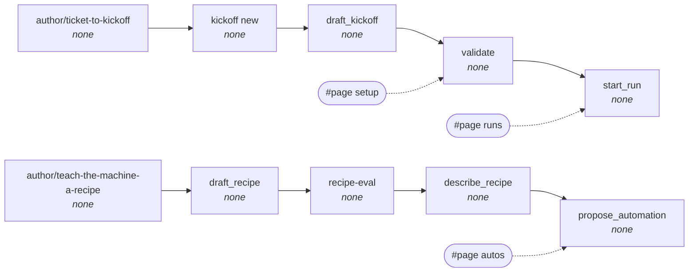
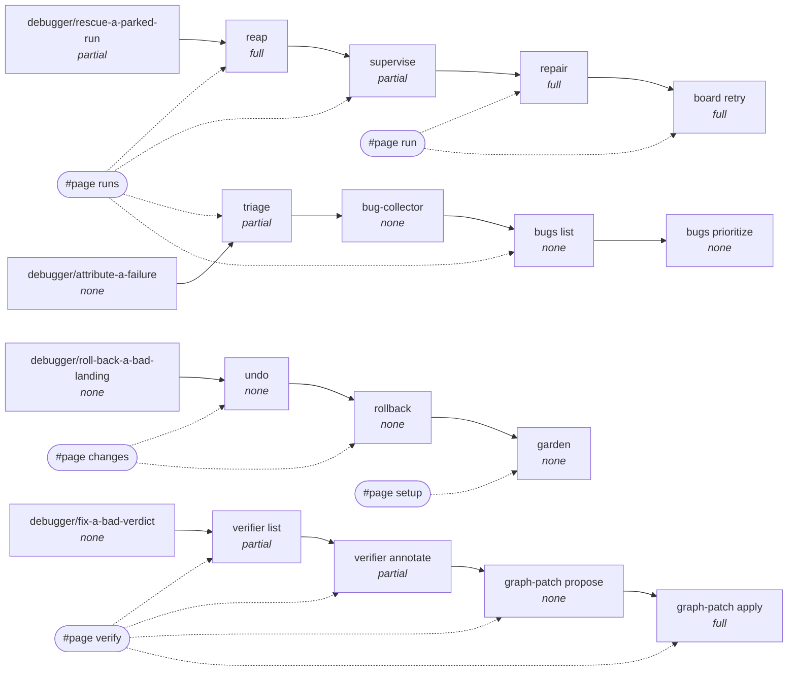
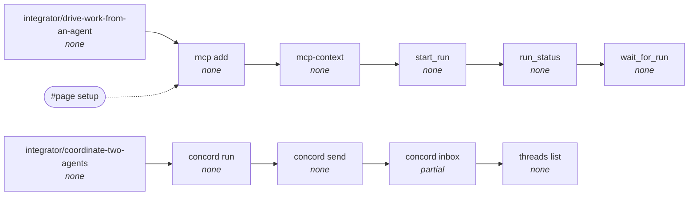
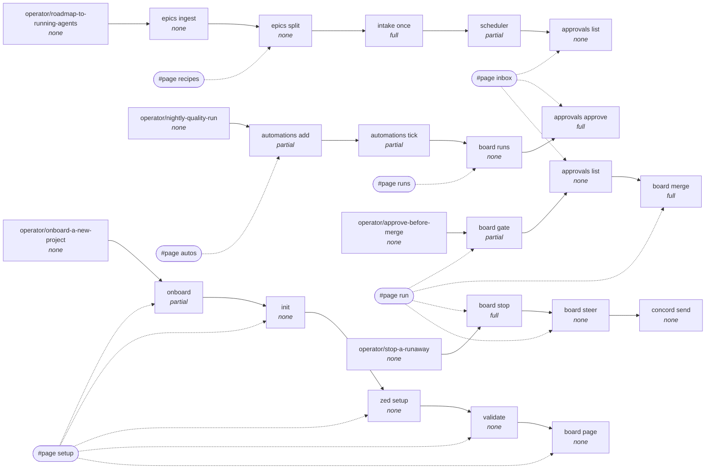

# Journey graph

Generated by `script/mo-journeys`; do not edit by hand.

Solid arrows are the order an engineer performs the steps in. Dashed
arrows are the page that hosts the step's action; a step with no page
is CLI- or MCP-only, which is the gap this corpus exists to find.

## analyst

## author

## debugger

## integrator

## operator

