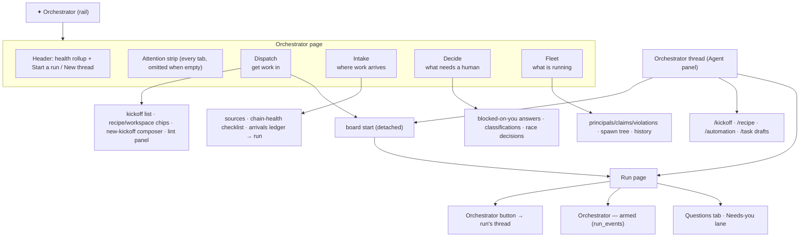

# The Orchestrator on the mini-ork front end — a product description

**Date** 2026-10-17 · **Status** product design brief · **Audience** product, design, engine and
IDE engineers.

**Companions.**
`2026-10-15-orchestrator-intake.md` (the audit — what was wrong),
`2026-10-15-orchestrator-intake-redesign.md` (the first design — ten journeys),
`2026-10-16-run-initiation-modes.md` (input-first initiation and the pre-flight sheet), and the
engine's binding spec `SourceShift/mini-ork:specs/orchestrator-page-redesign.spec.md`
(FR-001…FR-040, phases P0–P4 — all shipped). **Line anchors in the older briefs are stale; cite
function names.**

This document is the *product* view: what the orchestrator is to a person using mini-ork, how it
should feel and read on screen, and which of those things exist today. It does not prescribe new
engine internals; where it notes a gap, it says which layer owns it (engine payload vs. Rust
renderer vs. the operator).

---

## 0. One-page summary

The orchestrator is **not a chat tab**. It is the project's operator console: the single place
that answers three questions, in that order —

1. **What needs me right now?** (attention)
2. **What do I want to start?** (dispatch)
3. **What is the factory doing?** (fleet, intake, decisions)

A run also has its own orchestrator — a per-run decision core that speaks only when a node needs
intervention — but a *project's* orchestrator is a page, not a person. The page is the product.

**The shape to hold in the head.** One rail entry (`✦ Orchestrator`). A header that is a health
rollup, not a version tag. An attention strip that is identical on every tab and omitted when it is
empty. Content grouped by job, not by data source. Every row that names a problem carries the
control that fixes it. Nothing on the page is a control that draws and does nothing.

```
┌ ✦ Orchestrator ─────────────────────────────────────────────────────────────┐
│  ✦ Orchestrator   [3 sources · 1 wired] [scheduler on] [ContextNest ✓]      │
│                                          [Start a run]  [New thread]        │
│  ⚠ 2 runs waiting for you · 1 race undecided · intake synced 3d ago         │
│    [Answer in Decide]  [Decide the race]  [Poll now]                        │
├─────────────────────────────────────────────────────────────────────────────┤
│  Session │ Dispatch │ Decide │ Kickoffs │ Races │ Classify │ Coord │ Intake │
├─────────────────────────────────────────────────────────────────────────────┤
│  … the tab, composed of the engine's section vocabulary …                   │
└─────────────────────────────────────────────────────────────────────────────┘
```

Everything below expands that sketch.

---

## 1. What "orchestrator" means — three layers, one word

Users say "the orchestrator" about three different things. The product must keep them distinct on
screen, because conflating them is how the interface starts lying.

| Layer | What it is | Where a user meets it | What it costs |
|---|---|---|---|
| **Project orchestrator** | The page described here: dispatch, intake, decisions, fleet | Rail `✦` → Orchestrator | — |
| **Orchestrator thread** | A chat with a model that acts as a control plane — answer, start a run, edit directly, draft a kickoff/recipe/automation/task | `New thread`, `/orchestrator <run>`, any plain prompt in the Agent panel | model turns |
| **Per-run orchestrator** | A deterministic decision core at every DAG node boundary — `advance · help · repair · mutate · promote`. Default on, budget-capped, fail-safe | The run page: an `Orchestrator — armed` section, and an `Orchestrator` button that opens the run's thread | bounded (`MO_ORCH_BUDGET_USD`, default $1) |

### The buddy, and where it went

The **run buddy** was a per-run narrator that wrote a stage-report feed (`<run>/buddy/<epoch>.json`)
and had its own Story/Graph sections ("Buddy — N reports"). It was **removed on 2026-10-16**
(commit *"One orchestrator per run, and the run buddy is gone"*). The layer that replaced it is the
per-run orchestrator plus the ACP orchestrator thread, which narrates followed runs through
`acp_orchestrator/watch.py` — an opening line, two turns per stage, one per tripped signal, and a
closing report, braked by a narration budget.

**Product consequences, stated plainly:**

- The name *buddy* must not reappear in the UI. There is no "Buddy" section, no "0 reports" empty
  state, no stage-report feed to repair — `<run>/buddy/` has **no writer**, and nothing reads it.
- The run's narrator is now **`run_events`**, not a separate feed: rows with `event_type LIKE
  'orchestrator.%'`. The run page draws the six most recent, plus an unconditional
  `Armed — no interventions this run` line when the run was green. That line is the whole point:
  silence must read as *a fact* ("on but quiet"), never as *absence*.
- `MO_BUDDY_*` environment variables were renamed to `MO_WATCH_*`. An operator still exporting the
  old names gets a silent no-op; the engine now warns once rather than pretending.

If a future surface wants a richer timeline than six rows, it must build a writer first. A page that
renders a feed nobody writes is a lie with a scrollbar.

---

## 2. Product principles

These are the rules the brief is judged against. They are behavioural, not cosmetic.

1. **Attention before inventory.** The first thing on screen is what needs a human, never a list of
   what exists. If nothing needs the human, the attention area disappears — an empty
   "all clear" box costs a glance every visit and teaches people to skip the area that matters.
2. **Act where you see.** Every row that names a problem carries the button that resolves it. A
   diagnosis without an action is a support ticket.
3. **Infer, show, then let them override.** Never ask a question the system can already answer. When
   the system guessed, it says what it matched — "will run as `spec-driven-delivery`, matched
   `Spec dir:`" — because an explained guess is consent and an unexplained one is a trap.
4. **One truth.** The header, the strip, the tab and the run page must never disagree about a run's
   state. Where two views of one fact exist, they share one definition in the engine.
5. **No dead controls.** If an affordance draws, it works with the data on screen. Disabled is a
   stated reason, not a shrug; absent is better than disabled when the action can never apply.
6. **Nothing destructive without a stated consequence.** Merge, discard, stop, kill: each confirms
   with real numbers — which run, which worktrees freed, what is kept.
7. **Engine decides, renderer draws.** Status logic lives in the page payload, not in Rust. This is
   what keeps the web UI, the IDE and every future client honest with each other.

---

## 3. The map



The four job groups are the target IA. **Today the page ships eight tabs** — `Session`, `Dispatch`,
`Decide`, `Kickoffs`, `Races`, `Classify & plan`, `Coordination`, `Intake` — which are the four jobs
split one level finer, plus a home tab. See §9 for the honest status; §4 describes each tab as it
exists and says which job it serves.

---

## 4. The surfaces

### 4.1 Shell: header, strip, tabs

**Header (every tab).** A rollup of project health, four facts an operator wants on arrival:

- `3 sources · 1 wired` — is intake actually connected?
- `scheduler on` — will queued work ever start?
- `ContextNest ✓` — is coordination live?
- two primary buttons: **Start a run** (go to Dispatch) and **New thread** (open the orchestrator
  chat).

Today the header still carries a version tag (`mini-ork acp`) that nobody acts on. It should not.

**Attention strip (every tab).** One `triage` section, prepended to every tab and omitted entirely
when all four inputs are empty: runs parked on `needs_answers`, undecided races, failing intake
chain links, and page errors. Each item is a count pill beside the action that resolves it, and the
counts must equal what the target tab draws. The strip is a **to-do list**, not a status board.

**Tab strip.** Eight tabs, no badges today. Product target: a count where a tab has one to give
(`Decide · 2`, `Races · 1`). Empty tabs should read as quiet, not as a full-page callout.

**Section grid.** Two columns; sections are the engine's vocabulary (`triage`, `chips`, `pills`,
`table`, `list`, `composer`, `kv`, `code`, `callout`, `checks`, plus the run page's `dag` and
`inspector`). Nothing on this page invents a widget; see §7.

---

### 4.2 Session — the orchestrator's own settings and history

**Job.** "What will the orchestrator do by default, and what did we discuss?"

- **Three pickers, with provenance.** Orchestrator lane (`opus · sonnet · haiku`), default recipe,
  workspace. Each chip row names the layer the value came from — `env · features.yaml · lane map ·
  default` — because "why is it still opus" is otherwise unanswerable. Clicking a chip writes
  `features set-env`; the note says explicitly that a value set here **overrides the lane map**.
- **MCP tool wall** — 19 pills listing the orchestrator thread's tools. It is reference
  documentation occupying the top-right quadrant of the default tab. Product target: demote to a
  collapsed `code` block or move it to Fleet.
- **History** — recent threads and runs, distinguished by kind glyph (`▤ thread`, `◇ run`) with
  per-row cost. Every row opens: a thread continues the same conversation; a run opens its page.
  Today the note promises this and the rows are inert — the note is the requirement.

**Design stance.** Model is the only picker inside a *thread*. Recipe and workspace are the
defaults the orchestrator proposes. This page is where those defaults are set, and it must say so,
because a user who cannot find the recipe picker in the chat will look here first.

---

### 4.3 Dispatch — the front door

**Job.** "Get work in, now, without a chat."

Two designs have to be reconciled here, and both are right for different audiences:

- **Kickoff-first** (shipped, P1): pick a saved kickoff from a list, choose recipe and workspace
  chips, press Start.
- **Input-first** (proposed, 2026-10-16): ask what the user is *holding* — a folder of specs, one
  document, one feature, a bug, a goal, a roadmap, an existing kickoff, or nothing yet — infer the
  mode, and show a **pre-flight sheet** before anything starts.

The product answer is that input-first *contains* kickoff-first: a user who already has a kickoff
gets the same page with the source chip pre-selected to **Kickoff**. The kickoff list does not go
away; it becomes one of the inputs.

**Screen sketch (target).**

```
┌ What are you starting from? ────────────────────────────────────────────────┐
│ [ Spec folder ] [ Document ] [ Feature ] [ Bug ] [ Goal ] [ Roadmap ]       │
│ [ Kickoff ✓ ] [ Not sure yet ]                                              │
├─────────────────────────────────────────────────────────────────────────────┤
│ ▤ fix-auth-timeout.md                                                       │
│   code-fix · lint clean · last run-64879-1 ✓ done · 2d                      │
│                          [Start]  [Open]  [Open run]  [Log]                 │
│ ▤ add-linear-sync.md                                                        │
│   ⚠ no success section — add "## Success" … · code-fix · never run          │
│                          [Start]  [Open]  [Lint]                            │
├─────────────────────────────────────────────────────────────────────────────┤
│ Lint · fix-auth-timeout.md                              [Re-lint] [Open]    │
│ ✗ scope path does not exist: src/auth/session.ts → create it or mark "(new)" │
│ ⚠ no success section → add "## Success" with the commands that must pass     │
└─────────────────────────────────────────────────────────────────────────────┘
```

**The pre-flight sheet is the object the whole page exists for.** It is the last screen before an
irreversible spend, and it shows exactly the three things being committed to — recipe, workspace,
lane — plus why the recipe was chosen.

```
┌ Will run as ────────────────────────────────────────────────────────────────┐
│  spec-driven-delivery          family: Code · source: engine                │
│  matched  ## Spec dir:  in the kickoff                                      │
│  [ Change mode ▾ ]  ← chips: Code · Research · Product · Ops · …            │
├ Input ──────────────────────────────────────────────────────────────────────┤
│  specs/ · 14 specs — 11 ready, 2 blocked, 1 draft                           │
├ Flow ───────────────────────────────────────────────────────────────────────┤
│  ingest → per_spec_dispatcher → implementer → verifier → …                  │
├ Run ────────────────────────────────────────────────────────────────────────┤
│  workspace: worktree   lane: (orchestrator default)   ~$0.40–1.20           │
│  [ Start run ]   [ Dry run ]   [ Edit kickoff ]                             │
└─────────────────────────────────────────────────────────────────────────────┘
```

**Rules the sheet must obey:**

- **Start is gated only on a miss.** When no rule matched, the sheet says so and Start is disabled
  until a mode is chosen. A matched marker never gates.
- **The gate is honest.** A disabled Start carries the reason in place, in the page — not a toast
  after the click.
- **Correcting the matcher is part of shipping the gate.** A pasted stack trace scores zero against
  every class today (the `code-fix` matcher is five generic keywords and an inert `path_globs`).
  Without fixing that *data*, the gate turns the one journey that already works into a dead button.
  This is a named risk in the 2026-10-16 brief, not an implementation footnote.
- One question, not a wizard. If the sheet grows required fields, the design has failed.

**Starting is primary and unconfirmed.** Starting a run is the purpose of the page; a confirm dialog
on it would be parody. Confirmation belongs on destructive acts (merge, discard, stop), not on the
constructive one.

---

### 4.4 Decide — everything that unblocks the machine

**Job.** "A human judgement is stopping the factory. Make it a sentence and a click."

Three panels, in priority order:

1. **Blocked on you.** One entry per run waiting on `needs_answers`, longest wait first, with the
   question quoted verbatim, its wait time, and its own composer bound to `board answer`. Tone
   escalates with age; past an hour the entry also names the recipe and start time, so the cost of
   leaving it parked is visible. Today: shipped (P2).
2. **Classifications.** A table of the most recent profiled runs — run, task class, recipe,
   confidence, outcome — ordered **lowest confidence first**, with the note counting how many fall
   below the threshold. Selecting a row re-reads the detail below it, so the plan you see is the
   plan you clicked. Today: shipped read-only (FR-023).
3. **Router correction.** "This should have been a `chore`." The engine has
   `prefs set --scope task_class`; the page does not expose it. This writes durable behaviour for
   *future* runs, so it is a product decision, not a UI one — deliberately out of scope until an
   owner rules on it.

**Design stance.** The page never auto-answers and never resumes silently. An answer is a human act
with an audit trail (`profile-answers.json`), and a run that resumes because a model guessed would
destroy the reason the gate exists.

---

### 4.5 Kickoffs — the saved-work library

**Job.** "What have I saved, and is it any good?"

The kickoff list with lint verdicts, per-row Open / Open run / Log, and the lint panel for the
selected file. It is the same data as Dispatch's list, one lens different: Dispatch starts, Kickoffs
considers. Both must read from **one** scan and **one** lint badge helper so they cannot disagree.

A kickoff row's lint text is `{glyph} {msg} — {fix}`, not `{msg}`. The fix is the actionable half;
dropping it was a defect, not a density decision. A lint *error* still renders the row red and still
renders Start — a lint finding is advice, not a second invisible gate.

---

### 4.6 Races — the decision the page currently shows but cannot take

**Job.** "Four models ran the same kickoff overnight. Keep one, free the rest."

One section per race, not one table row: the contestants *are* the decision input and belong beside
the buttons.

```
┌ Race · fix-auth-timeout ───────────────────────────────────────────────────┐
│ ● opus      run-64879-a   ✓ verified  18/18 checks   $1.40   [Review]      │
│ ● sonnet    run-64879-b   ✗ 12/18 checks             $0.62   [Review]      │
│ ● glm       run-64879-c   ✗ verifier refuted         $0.55   [Review]      │
│ ● deepseek  run-64879-d   ✓ verified  17/18 checks   $1.27   [Review]      │
│                    [Keep opus] [Keep deepseek] [Discard all]               │
│   note: Keep merges the winner and discards the rest — 3 worktrees freed   │
└─────────────────────────────────────────────────────────────────────────────┘
```

Rules:

- The Keep confirm names the run kept, the runs discarded, and the worktrees freed — **numbers from
  a dry run**, not estimates drawn by the page.
- Nothing is discarded unless the merge landed. A partial failure is reported per run, not masked.
- A run whose kickoff cannot be read is drawn as its own race. Fail-closed has a visible cost, and
  that is the correct direction when the next step deletes work.
- Only the newest N races draw in full; the rest collapse behind "Earlier races".

---

### 4.7 Classify & plan — the router, made reviewable

The table lives under **Decide** in the target IA. Its product meaning: the classifier's recent
decisions are orderable by *doubt*, so a mis-route can be found by looking rather than by remembering
a run id. A profile that never recorded a confidence sorts last — a gate-skipping recipe is not the
worst decision the router ever made.

---

### 4.8 Coordination — the live fleet

**Job.** "Two agents are editing the same file. Who holds the claim, and can I stop one?"

Principals (pid, state, inbox, what it is), hot-file claims with expiry, `--owns` violations, and a
spawn tree. Every row carries its verbs: inbox, send, stop; open the violating path; stop the
holder. All of these already exist under `mini-ork concord`; the page simply had to wire them.

- `Send` is a composer, not a button: `concord send` requires a message a click cannot supply.
- `Stop` requires `--yes` because the IDE has no tty; the operator's gate is the action's own
  confirm.
- When ContextNest is unreachable the tab renders **one explanation and no actions** — not three
  empty tables. Empty tables read as "no problems", which is the opposite of true.

---

### 4.9 Intake — where work arrives on its own

**Job.** "A ticket got labelled. Did mini-ork pick it up? If not, why?"

- **Chain-health checklist** (`checks`): source registered → trigger configured → token present →
  scheduler running. Each row carries a state, a detail, and the CLI that repairs it. The summary
  counts come from the same rows, so the header cannot disagree with the list.
- **Arrivals ledger**: source, action, issue, **run**, when. The run cell is an openable link when a
  run exists; an em dash with no action when it does not. Rows written before the `run_id` column
  degrade silently — never as an error, never as a disabled button that implies a temporary state.
- **Per-source sync**: `Poll now` per source, only for sources that are registered.

The chain checklist is the page's best answer to "why is nothing starting", and it must stay on the
default path. A remedy written as prose ("check that the trigger is configured") is not a remedy.

---

### 4.10 The run page — the narrator

The run page is where the *per-run* orchestrator becomes visible. Three surfaces, deliberately
small:

1. **`Orchestrator` button** (run header actions) → `/orchestrator <run>`, opening the run's thread.
   It sits last in the action list because it is a way to *read* the run, not to change it.
2. **`Orchestrator — armed` section** on the Overview: the six most recent `orchestrator.*` events
   with node and reason, or — when the run was green — the sentence *"Armed — no interventions this
   run"*. It is unconditional so that "on but quiet" is a fact the page states.
3. **Questions tab** and the **Needs-you lane**: the human-facing half. Whatever the orchestrator
   could not decide itself becomes a question with an answer composer, not a log line.

The narration thread (`watch.py`) is a chat, not a page. Its product rules: never let the user stare
at silence during a long run; speak at stage boundaries and on tripped signals; keep a budget; and
report the ending in plain language — what changed, whether verification passed, the cost, the next
step.

---

### 4.11 The thread — control plane, not console

The orchestrator thread is reached from `New thread`, from `/orchestrator <run>`, or by typing a
plain prompt in the Agent panel. Its product contract:

- **Answer, start, or edit directly** — the model chooses per turn, and asks one short question when
  the choice genuinely matters.
- **Model is the only picker.** Recipe and workspace are proposed defaults (from Session), and the
  proposal is visible in the pre-flight/approval card rather than in a silent setting.
- **Drafts are approved, never assumed.** `/kickoff`, `/recipe`, `/automation`, `/task` all produce
  a staged artifact with a diff, its lint findings, and buttons. The orchestrator never claims the
  thing is created; the user creates it.
- **Merge and discard are never delegated.** When a run finishes, the user sees Merge / Discard and
  makes the call.

---

## 5. Journeys → screens

The ten journeys from the 2026-10-15 redesign plus the seven from the input-first brief collapse
onto the surfaces above. This is the coverage table a reviewer should use.

| # | Journey | Enters at | Ends at | Status |
|---|---|---|---|---|
| J1 | Start a run from a saved kickoff, with overrides | Dispatch | `board start` → board within a second | ✅ shipped |
| J2 | Did an arriving ticket start a run? | Intake → arrivals | run link / em dash | ✅ shipped |
| J3 | Draft a kickoff and get it lint-clean | Dispatch → composer | file + lint panel | ✅ shipped |
| J4 | Why is nothing starting? | Intake chain-health | repair action per failing link | ✅ shipped |
| J5 | Answer a run blocked on me | strip → Decide | `board answer`, run resumes | ✅ shipped |
| J6 | Decide a race | Races | `board race-keep` with a real confirm | ✅ shipped |
| J7 | Set the orchestrator lane / recipe / workspace | Session | chip → `features set-env` | ✅ shipped |
| J8 | See and drive the live fleet | Coordination | concord verbs per row | ✅ shipped |
| J9 | Review classifications and correct the router | Decide → classifications | table + detail (correction path open) | ✅ read-only |
| J10 | Resume an earlier conversation | Session → history | thread page | ✅ shipped |
| I1–I7 | Spec folder / document / feature / bug / goal / roadmap / nothing | Dispatch → source chips | pre-flight → Start | ⏳ not built |
| P | Pre-flight sheet (all seven inputs) | Dispatch | one Start button | ⏳ not built |

"Not built" is not a criticism of the shipped work — it is the next product increment, and it is the
one that makes every mode of mini-ork reachable without knowing a recipe id.

---

## 6. States and vocabulary

**Run states, as a user reads them.** `working · needs_you · done · failed · not_needed`. Never the
engine's snake_case in a chip. `not_needed` is a real terminal state — the operator closed the run —
and it must be distinguishable from `failed` everywhere, including any count tiles.

**Verification, as a trust signal.** The level vector (`applies · executes · target · preserve ·
contract`, each `PROVEN / UNVERIFIED`) is mini-ork's core claim. On screen it must:

- be explained in plain words on hover or click ("target PROVEN = the failing test now passes at the
  true base");
- never show green next to an unexplained `UNVERIFIED`;
- link to the evidence that decided it.

A green badge that cannot be interrogated is worse than no badge.

**Cost.** A chip with spend so far; per-node cost on the graph; and, when a cap exists, remaining
budget and a cost-pause state with Resume. "Money is being spent" is a state the operator should
never have to infer from a log.

---

## 7. Interaction rules the product inherits

These are constraints of the renderer, and the design leans *with* them rather than around them.

| Need | Primitive | Why it is enough |
|---|---|---|
| Pick a value | `chips` + `set_args` | A chip re-fetches the page with a new arg — a reload-driven picker. Trying two modes is two clicks with a live pre-flight below, which beats a dropdown that shows only a name. |
| Type something | `composer` | One text field whose contents become the last argv element of a CLI call. Used for answers, steering, new kickoffs, concord messages. A composer cannot hold a multi-paragraph kickoff — that draft is a stub, and `Open` is where the writing happens. Honest limitation, stated in the UI. |
| Act | `cli` argv, `page`, `set`, `run`, `path`, `thread` | There is no HTTP POST in the action vocabulary. Every write is a CLI verb; this is why `board start`, `board answer`, `board race-keep` exist as verbs rather than page-side calls. |
| Guard a destructive act | `confirm` on the action | Honoured on every action path (buttons, rows, chips, lane cards). `--force` does not bypass a gate; it records the human approval the confirm represents. |
| Pick files/folders | `pick_files` | Native OS picker. Folder selection needs the `directories` flag — the one renderer change the input-first design requires. |

**Two tiers, always.** Every verb the page calls must work (a) with no server, no daemon, no cloud
account — `mini-ork board …` against the default home — and (b) scoped per project with an explicit
`--home`/`MINI_ORK_HOME`, failing closed on an uninitialised home. The IDE uses the second tier; a
laptop uses the first; both reach the same code.

---

## 8. What makes the page trustworthy

1. **Never stale silently.** If a refresh fails, keep the last good content and say "stale since
   hh:mm · Retry". A background tab that missed updates must reload on activation.
2. **Never contradict itself.** DB status, header chip, strip count and the tab's own rows share one
   definition. Where they cannot, the page does not draw the second one.
3. **Never an empty box.** Empty states are one line, or nothing. "Buddy — 0 reports" is the
   canonical anti-pattern this product has already paid for once.
4. **Never a raw argv toast.** `mini-ork board start …: Done.` is not feedback. The toast says what
   happened ("Run started as spec-driven-delivery"), and concurrent actions do not overwrite each
   other's toast.
5. **Every error is visible.** The page payload's `errors` map is rendered as a warning callout on
   every tab. An engine error that only a terminal can see is not handled.

---

## 9. Status: what exists, what is owed

| Area | State | Where it stands |
|---|---|---|
| Orchestrator page, P0 wiring | ✅ shipped 2026-10-15 | errors callout, kickoff fix/log, settings chips with provenance, history links, fleet acts, chain health |
| P1 Dispatch | ✅ shipped 2026-10-16 | `board start`, `kickoff new`, Dispatch tab |
| P2 Answers | ✅ shipped 2026-10-16 | recent-run scan, `board answer`, blocked-on-you, classifications table |
| P3 Races / arrivals | ✅ shipped 2026-10-16 | `board race-keep`, `intake_events.run_id`, race panel |
| P4 Attention strip | ✅ shipped 2026-10-16 | one triage section, four inputs, omitted when empty |
| Renderer conformance | ✅ closed | seven engine↔fork gaps fixed; no redesign needed a renderer change |
| **GUI pixel replay** | ⏳ owed — operator | Launch the IDE, walk the rail entry and all eight tabs, confirm a `--force` prompt and a classifications row click. Only a real window settles it. |
| **Input-first initiation + pre-flight** | ⏳ not built | the 2026-10-16 brief, §8: `board preflight`, `resolved`, matcher data for `code-fix`, kickoff drafter, `directories` picker, page re-cut |
| **`not_needed` in the IDE** | ⏳ not built | engine emits five counts; the Rust `Counts` has four tiles and silently drops the fifth |
| **Tab badges / empty-tab quiet state** | ⏳ not built | needs the renderer to draw counts on the tab strip |
| **Router correction path** | ⏸ product call | `prefs set --scope task_class`; writes durable future behaviour |
| **A richer per-run timeline** | ⏸ blocked on a writer | six `orchestrator.*` rows today; a stage-report feed has no writer since the buddy was removed |

---

## 10. Non-goals

- **A chatbot as the product.** The thread is a powerful shortcut, not the front door. Anything a
  user must do every day belongs on the page, where it is discoverable and costs no tokens.
- **A mode picker.** The product never asks "which recipe?" cold. It asks what the user is holding
  and infers; the mode is shown and overridable.
- **New renderer widgets for this page.** Every section the design needs exists. A dropdown, row
  expansion or keyboard tab navigation is a 13-page decision and needs its own spec.
- **Resurrecting the buddy.** The removed layer's *job* (narration, steering) is served by the
  per-run orchestrator and its thread. The removed layer's *artifact* (a stage-report feed) has no
  writer and must not be drawn.
- **Merge/discard on the user's behalf.** The orchestrator proposes; the human decides.

---

## 11. How to judge it

The page is right when all of these are true:

1. Opening it cold, a person can say what needs them **without changing tabs** — or, when nothing
   does, the page says nothing about attention at all.
2. Every diagnosis on screen has a control beside it that resolves it.
3. Starting a run shows the recipe, workspace and lane **before** it spends, and when the system
   guessed the mode it says what it matched.
4. The same run cannot read `working` in one place and `failed` in another.
5. No section is ever an empty box, and no button is ever disabled without a reason in place.
6. All eight tabs build on a real home with `errors: {}` — the CLI half of the replay is green; the
   GUI half is the one remaining gate, and it belongs to the operator.

---

## Appendix — anchors (symbols, not lines)

| Claim | Anchor |
|---|---|
| Tabs, page build, attention | `mini_ork/ide_pages/orch.py` — `TABS`, `build`, `attention`, `_dispatch`, `_decide`, `_planner`, `_races`, `_coord`, `_intake`, `_recent_profiles` |
| Kickoff lint carries `fix` | `mini_ork/kickoff_lint.py` — `lint` |
| Launch, answers | `mini_ork/web/control.py` — `launch_run`, `get_profile`, `save_answers` |
| Verbs the page calls | `mini_ork/cli/board_cmd.py` — `build_parser`, `_act_start`, `_act_race_keep` |
| Per-run orchestrator | `mini_ork/orchestration/runner_orchestrator.py` — `decide`, `on_node_boundary`, `Action` |
| Run narration | `mini_ork/acp_orchestrator/watch.py`, `mini_ork/acp_orchestrator/prompt.md` |
| Run-page surfaces | `mini_ork/ide_pages/run.py` — `_orchestrator_action`, `orchestrator()` |
| Buddy removal | commit `fae2a7a5` *"One orchestrator per run, and the run buddy is gone."* |
| Binding requirements | `SourceShift/mini-ork:specs/orchestrator-page-redesign.spec.md` (FR-001…FR-040) |
| Renderer vocabulary | `crates/mini_ork_ui` — `page.rs::render_section`, `store.rs::perform` |
